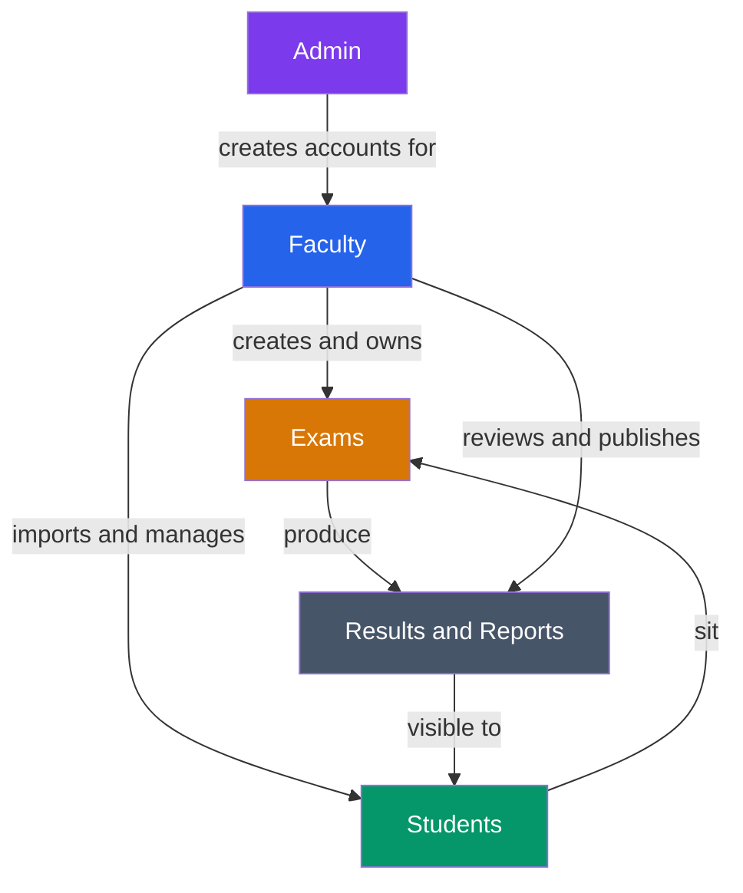
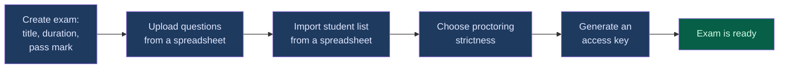
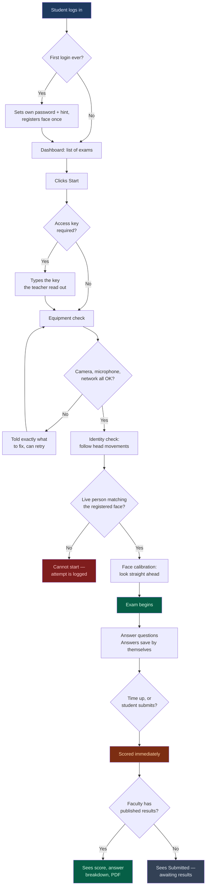
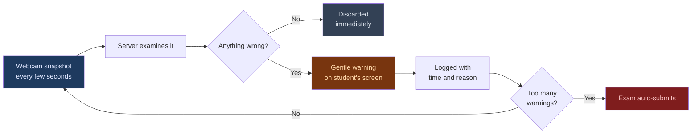
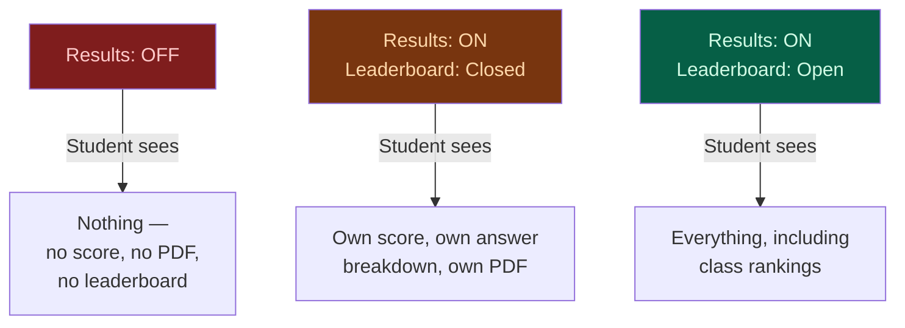
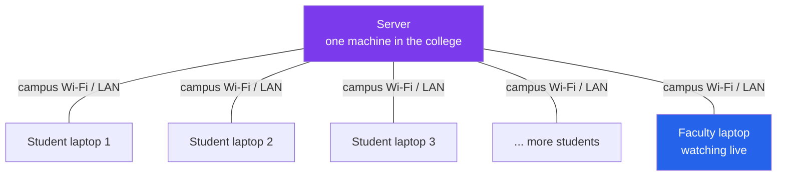

# Netra-I — What This Project Is

**A secure online exam system with an AI invigilator built in.**

Netra-I lets a college run written exams on computers instead of paper, while a camera-based
"digital invigilator" watches for the same things a human invigilator watches for — a student
leaving their seat, someone else appearing in frame, eyes drifting off the screen, a second
screen plugged in.

This document explains the project without any technical jargon. If you want database tables,
API routes and architecture, read **[README_TECHNICAL.md](README_TECHNICAL.md)** instead. For
installation, see the main **[README](../README.md)**.

---

## Table of Contents

1. [The problem it solves](#1-the-problem-it-solves)
2. [Who uses it](#2-who-uses-it)
3. [How an exam actually runs](#3-how-an-exam-actually-runs)
4. [What the AI invigilator watches for](#4-what-the-ai-invigilator-watches-for)
5. [What the faculty controls](#5-what-the-faculty-controls)
6. [What the student sees](#6-what-the-student-sees)
7. [Privacy — what is recorded and what is not](#7-privacy--what-is-recorded-and-what-is-not)
8. [Where it runs](#8-where-it-runs)
9. [What it is not](#9-what-it-is-not)
10. [Honest limitations](#10-honest-limitations)
11. [Glossary](#11-glossary)

---

## 1. The problem it solves

Running an exam for a few hundred students traditionally means printing papers, arranging a hall,
putting one invigilator per 30 students, collecting sheets, and then spending days marking them.

Online exams fix the paperwork but create a new problem: **nobody is watching.** A student at a
laptop can open another tab, keep notes beside the keyboard, or have a friend sitting off-camera.

Netra-I addresses both halves:

| Traditional problem | How Netra-I handles it |
|---|---|
| Printing, distributing, collecting papers | Everything on screen; nothing to print |
| One invigilator per ~30 students | The camera watches every student individually |
| Days of manual marking | Scored the instant the student submits |
| "Did anyone cheat?" is a guess | Every flagged moment is logged with a timestamp |
| Results take a week to compile | Faculty publishes with one click |

---

## 2. Who uses it

There are three kinds of people in the system, and each sees a completely different screen.

**Admin** — the person who runs the installation. Creates faculty accounts, can see every exam
across the whole college, and has a direct database window for emergencies.

**Faculty** — a teacher. Creates exams, uploads questions from a spreadsheet, imports their
student list, watches exams while they run, reviews anything the AI flagged, and decides when
marks become visible.

**Student** — sits the exam. Logs in, passes an equipment check, answers the questions,
submits, and later sees their result if the faculty has published it.

An important design choice: **departments are walled off from each other.** A teacher sees their
own exams and those of colleagues in the same course or department, never another department's.
One department's question paper, results and evidence photos are invisible to another's. Only the
admin sees everything.

---

## 3. How an exam actually runs

### Before the exam — the faculty's work

Questions come from a CSV or Excel file — one row per question, with the question text, four
options, and which one is correct. A hundred questions is one file and one upload.

Student lists work the same way. Each student gets an account automatically, with their own
random temporary password. Right after the import the teacher downloads a sheet listing those
passwords (it can be downloaded once) and hands each student their line. Students must change
the password the first time they log in. Nobody shares a default password, so nobody can sign in
as a classmate who hasn't logged in yet.

On shared lab computers a login never outlives the browser: closing it signs the student out,
and a session left idle for an hour ends by itself, so the next person at that seat starts fresh.

### During the exam — the student's journey

The **access key** is checked before anything else. Until the right key is typed, the questions are
not even sent to the student's computer, so nobody can read the paper early or from home. Five
wrong guesses lock the student out of key entry for ten minutes.

The **equipment check** is the part students notice most. Before anyone can start, the system
verifies the camera works, the microphone picks up sound, the internet is stable, and no second
monitor is plugged in. It is deliberately strict — it is far better to catch a broken webcam
before the exam than twenty minutes in.

The **face calibration** step takes about half a second. The student looks straight at the screen
and the system memorises their normal head position. Everything afterwards is measured as a
deviation from *their own* baseline, not from some fixed idea of "looking straight". A student who
naturally sits with their head slightly tilted is not penalised for it.

The **identity check** happens on exams that use the camera. The student is asked to look at the
camera and turn their head in a direction chosen at random. The server confirms that a real, moving
person is there (a photo or a phone screen held up to the camera fails), and that it is the same
person who registered their face on first login. If it does not match, the exam will not open and
the attempt is flagged for the teacher. During the exam the same comparison quietly repeats, so a
swap halfway through is also caught.

### After the exam — the faculty's review

The moment a student submits, the paper is marked. Faculty then get a dashboard showing every
student's score, how long they took, and — importantly — **anything the AI flagged**, with
timestamps.

Faculty can look at a flagged attempt and decide it was nothing (a student rubbing their eyes) or
decide it was serious and **invalidate** that attempt with a written reason. The reason is stored
alongside the result, so the decision is auditable later.

Only when faculty press **Publish** do students see their marks.

---

## 4. What the AI invigilator watches for

Every few seconds, the student's browser quietly takes a small snapshot from the webcam and
sends it to the server. The server looks at it, decides whether anything is wrong, and **throws
the snapshot away** unless it found a problem.

### The four things it looks for

**Nobody in front of the camera.** If the seat is empty for longer than the allowed gap, that is
flagged. Brief absences — reaching for a glass of water — are tolerated by the timeout.

**More than one face.** A second person appearing behind or beside the student is flagged
immediately. This is the single most useful signal in practice.

**Head turned away for too long.** Measured against the student's own calibrated baseline, and
only counted if it *persists*. A quick glance down at the keyboard is normal and ignored; staring
off to the left for several seconds is not.

**Phones and books on the desk.** Object detection. This is optional and off by default, because
it needs extra model files that are not shipped with the project.

### The browser also watches itself

Separately from the camera, the exam page notices if the student switches to another tab, leaves
full-screen, or tries to record the screen. Tab switches are counted, and the faculty sets how
many are allowed before it becomes a problem.

### It is designed to be forgiving

This is a deliberate philosophy in the system, visible in the actual wording it uses:

- Warnings say *"Gentle reminder (3/25): Please face the screen"* — not accusations.
- The default allowance is **25 warnings** before anything is auto-submitted. That is a lot of
  rope, on purpose.
- There is a **cooldown** between warnings, so one bad moment cannot burn through five warnings
  in five seconds.
- Each *type* of problem has its own cooldown, so a face warning does not mask a separate
  second-person warning.
- The system **adapts** as the exam goes on. If a student gradually settles into a slightly
  different posture, the baseline drifts with them.

The intent throughout is that the AI flags things for a human to judge — it is not meant to be
judge and executioner.

---

## 5. What the faculty controls

**Exam setup:** title, description, how many minutes, pass percentage, whether questions are
shuffled per student.

**Who can sit it:** everybody, or a hand-picked list. Optionally an access key — a short code the
teacher reads out in the hall, so nobody can start early or from home.

**Proctoring strictness:** three levels.

| Level | Behaviour | Good for |
|---|---|---|
| **Low** | Must turn head far before it counts; only clear faces detected | Home exams, patchy webcams |
| **Medium** | Balanced — the default | Most exams |
| **High** | Small movements count; detects faces at low confidence | High-stakes, supervised halls |

Faculty also choose individually whether camera, head-tracking, object detection, microphone
monitoring and tab-switch counting are each on or off.

**Live control while the exam runs:** extend everyone's time, end the exam for everybody, or end
it for one specific student who is having trouble.

**Results visibility:** two separate switches, and the relationship between them matters.

**Results must be ON first.** The leaderboard shows marks, so turning it on by itself would leak
scores that were meant to stay hidden — the system refuses to do that and warns the faculty.

These switches work two ways: from the dashboard they flip *every* exam at once, and from an
individual exam page they flip just that one.

**Reports:** a printable PDF per student with their answers and any proctoring notes, a
batch report across a whole class, and CSV exports.

---

## 6. What the student sees

**Dashboard** — their name, PRN, which exams are available, which are done, and their overall
performance so far.

**The exam screen** — one question at a time, a visible countdown, a grid showing which questions
are answered and which are skipped, and a small camera preview so they can see they are properly
in frame. Answers save automatically in the background; there is no "save" button to forget.

**During the exam the site navigation disappears** — no logout button, no back link. The exam
screen is the only screen.

**Afterwards** — if results are published: their score, which questions they got right and wrong,
where they placed if the leaderboard is open, and a downloadable PDF. If results are not yet
published: a clear "submitted, awaiting results" message rather than a confusing blank page.

---

## 7. Privacy — what is recorded and what is not

This deserves a straight answer, because students will ask.

### What is NOT kept

- **The camera is not recorded.** There is no video file of the exam anywhere.
- **The routine snapshots are not kept.** A snapshot arrives every few seconds, is examined in
  memory, and is discarded. Only snapshots taken *at the moment of a flagged violation* are kept.
- **Identity-check images are not kept.** The few frames sent during the identity check are
  examined and discarded. During the exam only a list of numbers describing the face is sent for
  comparison, and that is not stored either.
- **The microphone is not recorded.** Only a loudness number is used — enough to know that sound
  is happening, not enough to know what was said.

### What IS kept

- **A photo at each flagged moment.** When the AI raises a warning, that one frame is saved as a
  JPEG with the violation type stamped on it, filed under the exam and the student's PRN. This is
  the evidence a faculty member needs to judge whether a flag was real.
- **A written log line per flag** — what type, when, and the head-angle numbers behind it.
- **Counts** — total warnings, tab switches, how many times no face was visible.
- **The calibration baseline** — three numbers describing the student's normal head position.
- **One face registration per student.** A short list of 128-number vectors (about 1.5 KB)
  describing facial geometry — not a picture, and a picture cannot be reconstructed from it. It is
  recorded once, at first login, and is required for exams that use the camera. Students cannot
  change it themselves, so nobody can quietly register a stand-in. A teacher or admin can reset
  it, and every reset is permanently logged with who did it and why. Password login always works;
  signing in by face is an optional convenience.
- **A log of identity checks** — when, pass or fail, and why a check was rejected.
- **Answers and score**, obviously.

So: **no continuous recording, but flagged moments are photographed.** That is the honest summary,
and it is worth telling students up front.

### Who can see it

Only faculty with access to that exam (the owner and colleagues in the same department), and the
admin. Faculty from other departments cannot. Other students certainly cannot — the evidence
photos are not reachable by link, even for someone who guesses the file name.

### When it is deleted

Evidence photos are deleted when the teacher publishes results. A teacher can also delete an
individual photo while reviewing. Logs, counts and scores are kept with the result.

---

## 8. Where it runs

Netra-I is built to run **on a college's own machine** — a lab PC or a small server — with
students connecting over the campus network. No cloud account, no per-student fee, no data
leaving the building.

Students just open a browser and type an address. Nothing to install on their machines.

One practical note: **browsers only allow camera access over a secure connection.** For students
on other machines, the server must be started in its secure mode, or their cameras will refuse to
turn on. The project ships a script that sets this up.

It can also run in Docker, and the database can move from the built-in file-based one to a proper
database server when the student count grows.

---

## 9. What it is not

Being clear about this avoids disappointment:

- **Not a lockdown browser.** It runs in a normal browser and watches for suspicious behaviour;
  it does not take over the student's computer. A determined person with a second physical device
  is outside what any browser-based tool can catch.
- **Not a plagiarism checker.** It watches people, not text.
- **Not a proof of cheating.** It produces *flags for a human to judge*. The faculty decides.
- **Not a video conferencing tool.** Faculty do not watch live video feeds of students.
- **Not currently proven at 300 concurrent students.** See below.

---

## 10. Honest limitations

Worth knowing before planning a large exam:

**One process does all the vision work.** Every student's camera frames are examined on a single
server process, and that is the limit on how many students one machine can watch. Measured at
~15.6 ms per frame, which is where the ~250 figure above comes from.

**Camera quality matters.** A dim room or a cheap webcam produces more false flags. The three
strictness levels exist largely to compensate for this.

**Scale has a measured ceiling.** On the machine this was benchmarked on, one server process
handles roughly **250 concurrent students** before camera checks start falling behind. 300 is
within reach but needs the next round of work — see the technical README.

**No internet needed.** Everything the exam pages use, including the face-recognition files, is
served by the exam server itself, so an exam hall network can be completely cut off from the
internet.

**Storage grows between publications.** Every flagged moment is a JPEG on disk. They are removed
when results are published, but an exam whose results are never published keeps its photos.

**Older student accounts are shared.** Students imported from now on belong to the department
that imported them. Accounts created before that, and students who registered themselves, have
no owner yet, so every teacher can see them until an administrator assigns one.

---

## 11. Glossary

| Term | Plain meaning |
|---|---|
| **Proctoring** | Invigilating — watching students during an exam |
| **Calibration** | The half-second at the start where the system learns your normal head position |
| **Violation / flag** | A moment the AI thought looked wrong. Not a verdict — a note for the teacher |
| **Access key** | A short code the teacher reads out so nobody starts the exam early |
| **PRN** | The 12-digit roll number identifying a student |
| **Auto-submit** | The exam submitting itself, because time ran out or too many warnings piled up |
| **Invalidate** | A faculty decision that an attempt does not count, with a written reason |
| **Publish results** | The switch that makes marks visible to students |
| **Leaderboard** | Class rankings by score. Needs results published first |
| **Tab switch** | Leaving the exam page for another tab or window. Counted |
| **Head pose** | Which way your head is pointing, in degrees |
| **LAN** | The college's own network. Fast, local, private |
| **Face registration** | The one-time recording of a student's face geometry at first login, used to confirm identity before camera exams |
| **Liveness check** | Turning your head as instructed, so the system knows a real person is there rather than a photo |

---

## Where to go next

- **[README](../README.md)** — installation, configuration and project layout.
- **[README_TECHNICAL.md](README_TECHNICAL.md)** — architecture, database schema, every API route,
  the proctoring pipeline in detail, and a measured analysis of the scaling ceiling.
- **[LAN_DEPLOYMENT_GUIDE.md](LAN_DEPLOYMENT_GUIDE.md)** — running it on a campus network.
