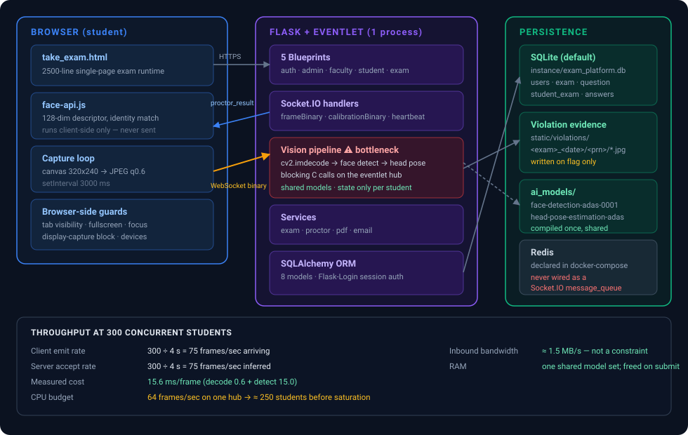
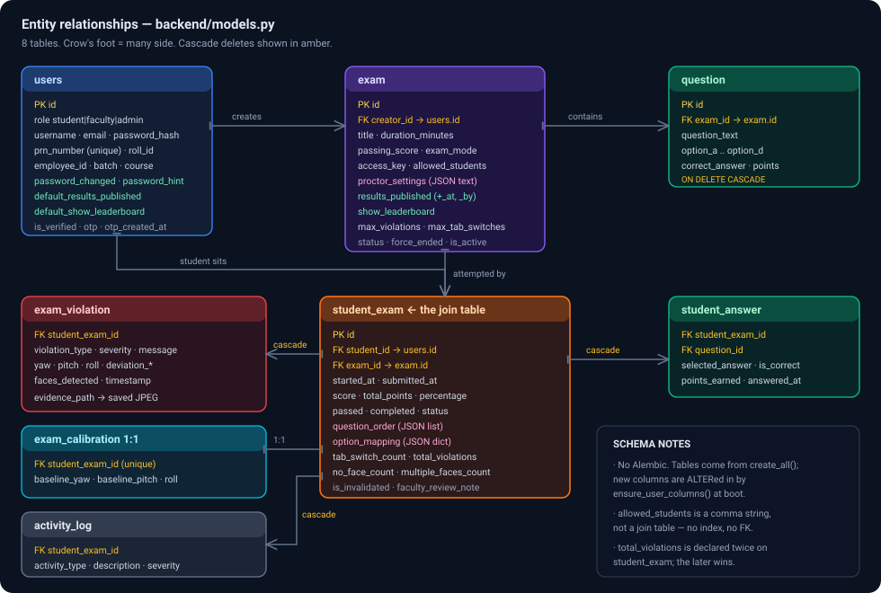
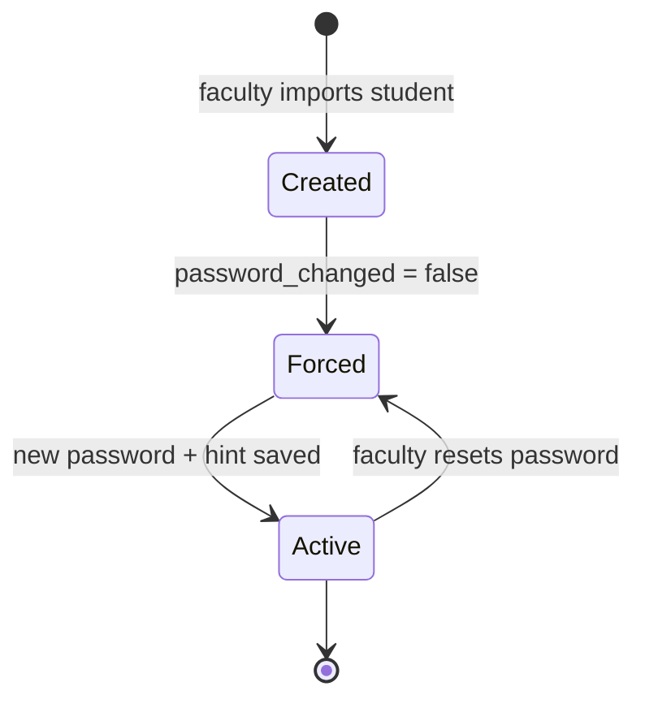
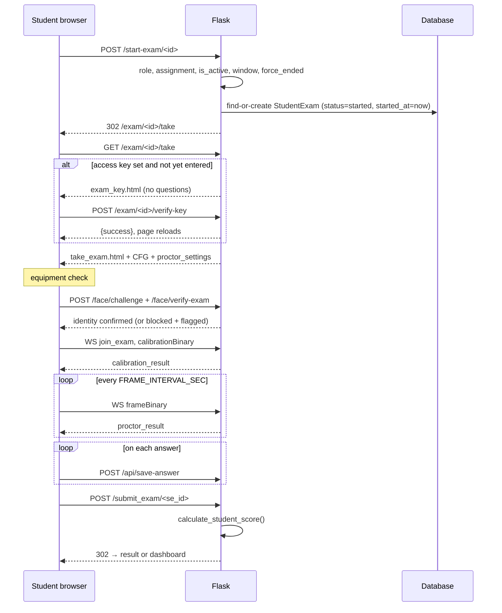
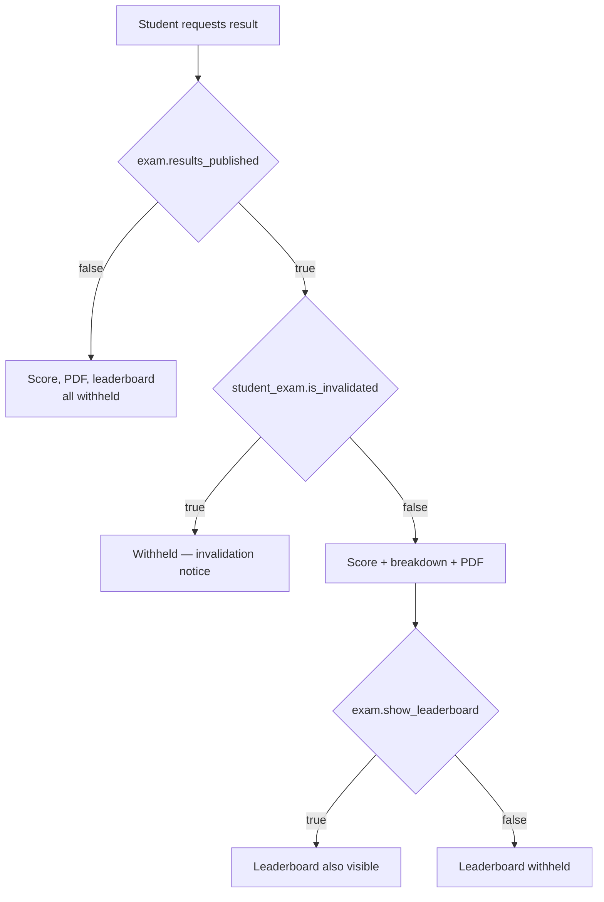
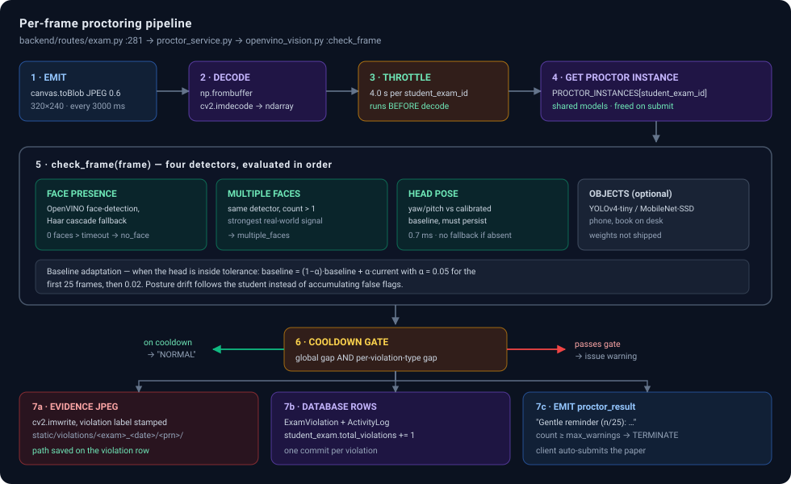
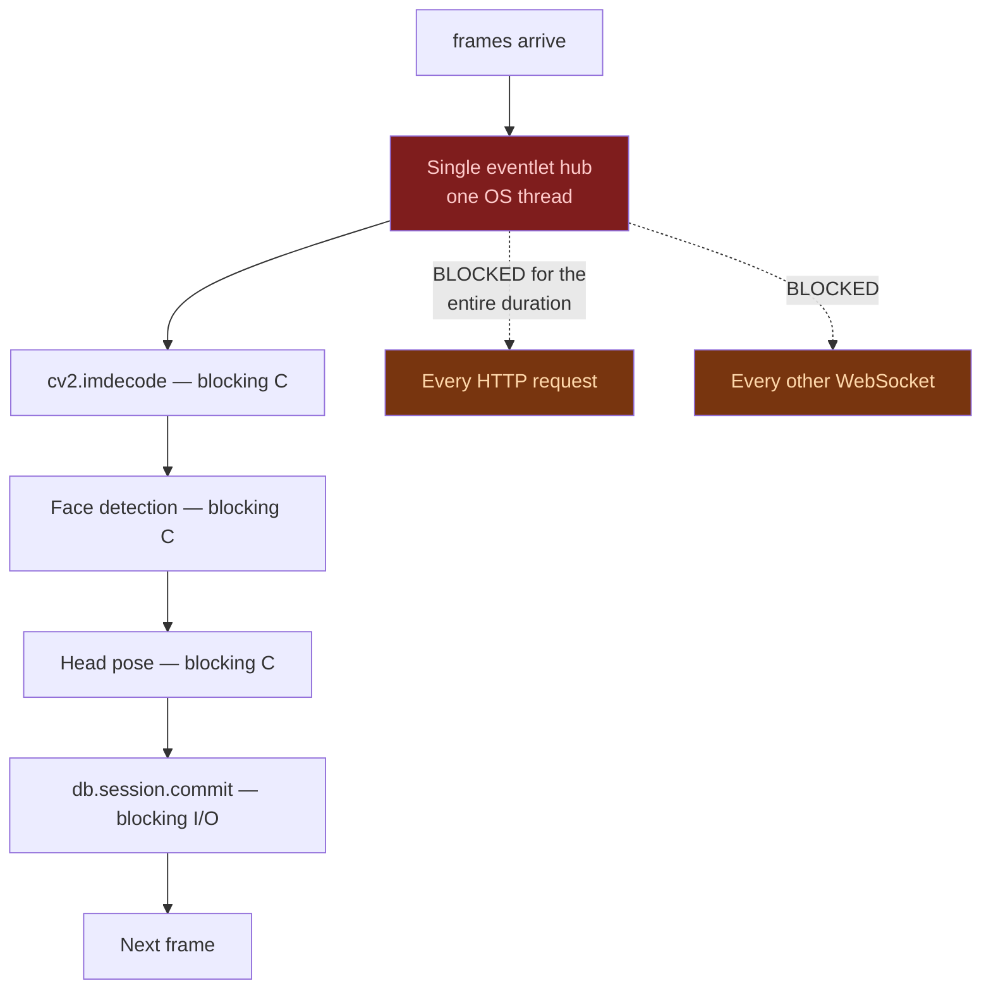

# Netra-I — Technical Reference

Architecture, data model, API surface, the proctoring pipeline, the security model, and a
measured analysis of where the system breaks under load.

For a non-technical description, read **[README_OVERVIEW.md](README_OVERVIEW.md)**. For
installation and configuration, read the main **[README](../README.md)**.

> **Accuracy note.** Everything here was read from the source and checked against the test suite
> (`tests/`). Where behaviour is incomplete, §13 says so explicitly.

---

## Table of Contents

1. [Stack and versions](#1-stack-and-versions)
2. [Repository layout](#2-repository-layout)
3. [Runtime architecture](#3-runtime-architecture)
4. [Application bootstrap](#4-application-bootstrap)
5. [Data model](#5-data-model)
6. [Authentication](#6-authentication)
7. [Authorization and data isolation](#7-authorization-and-data-isolation)
8. [Exam lifecycle](#8-exam-lifecycle)
9. [The proctoring pipeline](#9-the-proctoring-pipeline)
10. [Socket.IO event contract](#10-socketio-event-contract)
11. [HTTP API surface](#11-http-api-surface)
12. [Security model](#12-security-model)
13. [Known gaps](#13-known-gaps)
14. [Scaling analysis](#14-scaling-analysis)
15. [Deployment](#15-deployment)
16. [Development and testing](#16-development-and-testing)
17. [Operational scripts](#17-operational-scripts)

---

## 1. Stack and versions

| Layer | Technology | Pinned version |
|---|---|---|
| Language | Python | ≥ 3.11 (pandas 3 / numpy 2.3 require it); Docker image uses 3.12 |
| Web framework | Flask | 3.1.2 |
| ORM | SQLAlchemy / Flask-SQLAlchemy | 2.0.46 / 3.1.1 |
| Auth | Flask-Login | 0.6.3 |
| Realtime | Flask-SocketIO | 5.6.0 |
| Async driver | eventlet | ≥ 0.35.0 |
| Vision runtime | OpenVINO | 2025.4.1 |
| Vision fallback / image ops | opencv-python | 4.13.0.90 |
| Numerics / imports | numpy / pandas | 2.3.5 / 3.0.0 |
| PDF | reportlab / fpdf | 4.4.9 / 1.7.2 |
| Client-side face descriptors | face-api.js (vendored, `static/vendor/face-api`) | 0.22.2 |
| Database | SQLite by default, any SQLAlchemy URL | — |
| Tests | pytest | not pinned |

---

## 2. Repository layout

```
Netra-I/
├── app.py                          # factory, schema top-up, secret key, request guards, CLI entry
├── wsgi.py                         # gunicorn entry point
├── requirements.txt · pytest.ini · .env.example
├── Dockerfile · docker-compose.yml · .dockerignore
│
├── backend/
│   ├── database.py                 # db = SQLAlchemy(), login_manager, SQLite WAL pragma
│   ├── models.py                   # 11 models (556 lines)
│   ├── socket_io.py                # SocketIO() singleton + origin policy
│   ├── security.py                 # CSRF token issue + check
│   ├── routes/                     # 5 blueprints (~3 400 lines)
│   │   ├── auth.py      (760)      #   login, register/OTP, password change, face sign-in & checks
│   │   ├── admin.py     (348)      #   faculty CRUD, all students/exams, SQL console
│   │   ├── faculty.py  (1508)      #   exams, students, visibility, live control, review, evidence
│   │   ├── student.py   (236)      #   dashboard, result, PDF, leaderboard, profile
│   │   └── exam.py      (503)      #   exam runtime + Socket.IO handlers
│   ├── services/
│   │   ├── exam_builder.py      (260)   # one validation path for single + batch exam creation
│   │   ├── exam_service.py              # scoring, shuffle, deadlines, overdue-attempt sweeper
│   │   ├── account_service.py           # temp passwords, student scoping, safe deletion
│   │   ├── question_splitter.py (281)   # split one bank into N papers (stateless)
│   │   ├── proctor_service.py   (197)   # per-attempt engine registry, violation logging
│   │   ├── face_service.py      (537)   # enrolment, matching, lockout, audit
│   │   ├── liveness_service.py  (514)   # challenge-response + presentation-attack detection
│   │   ├── pdf_generator.py     (801)   # reportlab result + batch reports
│   │   └── proctor_vision/
│   │       └── openvino_vision.py (850) # the computer-vision engine
│   └── utils/
│       └── email_utils.py       (319)   # OTP + result emails, console fallback
│
├── frontend/
│   ├── templates/                  # 26 Jinja2 templates
│   │   ├── base.html               # nav, theme, flash messages
│   │   ├── student/take_exam.html  # 2 738 lines — the exam runtime
│   │   ├── student/exam_key.html   # access-key gate
│   │   └── admin/ faculty/ student/
│   └── static/
│       ├── css/  (10 files; style.css is ~16 700 lines)
│       ├── js/   (analytics, face_liveness, student_management)
│       ├── vendor/                 # all third-party JS/CSS/fonts + face-api models (offline)
│       ├── images/
│       └── violations/             # evidence JPEGs, runtime-only, gitignored, staff-only
│
├── ai_models/                      # OpenVINO IR files (~12 MB, gitignored)
├── tests/                          # pytest suite — 5 modules, 128 tests
├── scripts/                        # create_admin, backup_db, repair_proctor_settings, LAN cert + launcher
├── deploy/                         # nginx template + installer
├── docs/                           # this file, overview, LAN guide, diagrams/, samples/, project/
├── archive/                        # retired code, not imported (see archive/README.md)
├── certs/                          # cert.pem + key.pem for --ssl (gitignored)
├── instance/                       # exam_platform.db + .secret_key (gitignored)
├── data/  backup/                  # local question banks, student lists, DB backups (gitignored)
```

---

## 3. Runtime architecture



Three tiers, one process.

**Browser.** `take_exam.html` is a self-contained runtime: a `CFG` object injected server-side,
a state machine, a capture loop, browser-level guards (tab visibility, fullscreen, focus,
`getDisplayMedia` interception, device enumeration), and face-api.js for identity descriptors.
It talks to the server over HTTP(S) for answers and over a Socket.IO WebSocket for camera frames
and live control events.

**Server.** A single Flask process under eventlet. Five blueprints handle HTTP; Socket.IO
handlers take binary frames and push force-end events into per-exam and per-attempt rooms. The
vision pipeline runs *inline on the same event loop*, which is the central scaling constraint —
see [§14](#14-scaling-analysis).

**Persistence.** SQLite by default via `DATABASE_URL`, in WAL mode. Evidence photos are written to
`frontend/static/violations/`. OpenVINO models load from `ai_models/` (or `NETRA_MODEL_DIR`) and
are compiled once per process.

Redis appears in `docker-compose.yml` but **nothing in the application connects to it.** There is
no `message_queue` argument on `SocketIO()`, so multi-worker Socket.IO is not currently possible.

---

## 4. Application bootstrap

`create_app()` in [app.py](../app.py) is the factory.

```python
app = Flask(__name__,
            template_folder='frontend/templates',
            static_folder='frontend/static')
```

**Configuration:**

| Key | Source | Default |
|---|---|---|
| `SECRET_KEY` | `SECRET_KEY`, else `load_secret_key()` | random 256-bit key persisted to `instance/.secret_key` (0600) |
| `SQLALCHEMY_DATABASE_URI` | `DATABASE_URL` | `sqlite:///exam_platform.db` → `instance/exam_platform.db` |
| `MAX_CONTENT_LENGTH` | `MAX_CONTENT_LENGTH` | 16 MB |
| `SESSION_COOKIE_SECURE` | `--ssl` flag or `USE_SSL=true` | `False` |
| `SESSION_COOKIE_HTTPONLY` / `SAMESITE` | — | `True` / `Lax` |
| `PERMANENT_SESSION_LIFETIME` | — | 3600 s |

**Boot sequence:**

1. `db.init_app` · `login_manager.init_app` (`session_protection = 'strong'`)
2. `socketio.init_app`
3. `@app.after_request` — `Permissions-Policy: camera=(self), microphone=(self), …` and `no-store`
4. `register_blueprints(app)` — the five blueprints
5. `db.create_all()`
6. `ensure_schema_columns()` — the migration substitute (below)
7. `@app.before_request` guards — `protect_violation_evidence` and `force_password_change`
8. Print the route table

### Schema migration strategy

There is **no Alembic**. `db.create_all()` creates missing *tables* but never adds *columns* to
existing ones. `ensure_schema_columns()` walks `LATE_COLUMNS` — currently covering `users`,
`face_enrollment` and `face_login_attempt` — and issues `ALTER TABLE … ADD COLUMN` for anything
missing. Each addition is wrapped in try/except with rollback, so a partial failure does not
abort boot. It is additive only: no type changes, drops or down-migrations. Introducing Alembic
is a prerequisite for a multi-environment deployment.

### Request guards

```python
@app.before_request
def csrf_protect():               # backend/security.py — token on every POST/PUT/PATCH/DELETE

@app.before_request
def enforce_idle_timeout():       # sign out after SESSION_IDLE_MINUTES without a request

@app.before_request
def protect_violation_evidence():
    # /static/violations/* → 403 unless the user is faculty or admin

@app.before_request
def force_password_change():
    # students with password_changed == False may only reach the change-password page
    # (and the face-enrolment endpoints that live on it); XHR gets a 403 JSON instead
```

---

## 5. Data model



Eleven models in [backend/models.py](../backend/models.py).

### `users`

One table for all three roles, discriminated by `role`.

| Column | Notes |
|---|---|
| `prn_number` | 12-digit, unique, nullable — students. Blank imports are stored as `NULL`, never `''` |
| `employee_id` | unique, nullable — faculty |
| `password_changed` / `_at` / `password_hint` | first-login flow; `must_change_password` is a derived property |
| `default_results_published` / `default_show_leaderboard` | faculty preferences inherited by new exams |
| `otp` / `otp_created_at` | 6 digits from `secrets`, 600 s TTL enforced in `verify_otp()` |
| `created_by` | staff member who created a student account (import); scopes faculty access. `NULL` for self-registered and pre-existing accounts |

### `exam`

Owned by `creator_id`.

- **Access:** `allow_all_students`, `allowed_students` (comma-separated ID string), `access_key`,
  `is_active`, `start_time` / `end_time`
- **Proctoring:** `enable_proctoring`, `max_violations`, `max_tab_switches`, `exam_mode`
  (`classroom` | `home`), `proctor_settings` (JSON text, merged over `PROCTOR_DEFAULTS`)
- **Visibility:** `results_published` (+ `_at`, `_by`), `show_leaderboard`, `post_exam_redirect`
- **Live state:** `status` (`ended` after force-end, `active` after reactivation), `force_ended`

Derived properties encode the visibility rule:

```python
@property
def results_visible_to_students(self):
    return bool(self.results_published)

@property
def leaderboard_visible_to_students(self):
    # the leaderboard exposes marks, so it also needs results published
    return bool(self.show_leaderboard) and self.results_visible_to_students
```

### `student_exam`

The attempt — the hub every runtime table hangs off.

- **Scoring:** `score`, `total_points`, `percentage`, `passed`, `time_taken_minutes`
- **Lifecycle:** `status` (`in_progress` = pre-created at import, `started`, `submitted`),
  `started_at`, `submitted_at`, `completed`
- **Shuffle:** `question_order` (JSON list of IDs), `option_mapping` (JSON `{qid: ['C','A','D','B']}`)
- **Proctoring:** `total_violations`, `no_face_count`, `multiple_faces_count`, `tab_switch_count`,
  `proctoring_status` (`active` | `terminated`), `calibration_completed`
- **Review:** `is_invalidated`, `faculty_review_note`, `reviewed_by`, `reviewed_at`
- `result_visible_to_student` — published *and* not invalidated
- **Constraints:** unique `(student_id, exam_id)`; `student_answer` is unique on
  `(student_exam_id, question_id)`. Both are added to existing databases at start-up by
  `ensure_schema_indexes()`, together with indexes on the hot foreign keys. SQLite foreign keys
  are enforced (`PRAGMA foreign_keys=ON`).

### Runtime tables

| Model | Purpose |
|---|---|
| `question` | Cascades on exam delete. `correct_answer` is A–D, `points` default 1 |
| `student_answer` | `selected_answer`, `is_correct`, `points_earned`. Unanswered questions are materialised at scoring time with `selected_answer = "0"` |
| `activity_log` | Client-reported events (tab switches, recording attempts) and a mirror of every proctoring violation |
| `exam_calibration` | Three floats — baseline yaw, pitch, roll |
| `exam_violation` | Type, severity, message, pose numbers, `faces_detected`, `evidence_path` |

### Face tables

| Model | Purpose |
|---|---|
| `face_enrollment` | 1:1 with a user. 2–5 packed float32 128-dim descriptors (`LargeBinary`, 512 B each). `is_locked` (set on enrolment), `enrolled_by`, `reset_by`/`reset_at`, liveness score and method |
| `face_login_attempt` | Every face sign-in / exam check: identifier, distance, reason, IP, liveness outcome, spoof score, per-frame detail JSON, `stage` (`enroll` \| `login` \| `exam`) |
| `face_audit_log` | Permanent record of every enrol / reset / delete — subject, actor, actor role, reason, IP |

---

## 6. Authentication

Flask-Login, cookie sessions, `session_protection = 'strong'`.

### Password login

`POST /login` accepts one identifier matched against username, email (lower-cased), PRN or roll
ID. Passwords are `pbkdf2:sha256`. On success:

1. `is_verified == False` → OTP verification page
2. `must_change_password` → `/change-password`
3. otherwise → role dashboard

Failures are counted per identifier (`pw:<identifier>`); after **5** the identifier is locked for
**10 minutes** and the endpoint returns 429.

> `roll_id` is not unique. If two students share one, `.first()` picks one arbitrarily — prefer
> username, email or PRN.

### Sessions

Sessions are browser-session cookies (`HttpOnly`, `SameSite=Lax`, `Secure` under `--ssl`). No
"remember me" cookie is issued, so closing the browser ends the login, and
`enforce_idle_timeout` signs out a session idle for `SESSION_IDLE_MINUTES` (default 60) — the
exam page polls, so an exam in progress never looks idle. Login and logout clear the session.
This matters because lab PCs are shared between exam batches.

### Self-registration and OTP

`POST /register` **always creates a `student`** — any posted `role` is ignored. Faculty are
created only by an admin. The PRN, if supplied, must be 12 digits and unique; blank optional
fields are stored as `NULL`. The account is created unverified with a CSPRNG OTP, and
`send_otp_email(email, otp, username, role)` delivers it (printed to the console when SMTP is not
configured). Self-registered users chose their own password, so they are not forced to change it.

`POST /verify-otp` uses `User.verify_otp()`, which enforces the 600-second expiry. Wrong codes
count toward a per-email lockout (5 / 10 min). `POST /resend-otp` issues a fresh code for an
unverified account.

### First-login password flow



`POST /change-password` validates, in order: all fields present → current password correct →
confirmation matches → ≥ 6 characters → differs from current → hint rules. The hint is mandatory
for students, ≤ 255 characters, and rejected if it contains the new password. `POST
/password-hint` returns one generic 404 for "no account" and "no hint", so it cannot enumerate
users, and the client renders the hint with `textContent`.

Imported students without a password column get a **random** 10-character temporary password
(`account_service.generate_temp_password`). The generated list is written once to
`instance/credentials/<token>.csv`, bound to the importing session, and deleted when downloaded
from the banner on *Manage Students*.

A faculty reset (`/faculty/change-student-password/<id>`, students in scope only) sets a new
random temporary password, returned once in the response and shown in the modal, and clears
`password_changed`, `password_changed_at` and `password_hint`.

### Face enrolment and sign-in

Implemented in [face_service.py](../backend/services/face_service.py) and
[liveness_service.py](../backend/services/liveness_service.py); routes in
[auth.py](../backend/routes/auth.py); client in `frontend/static/js/face_liveness.js`.

**Liveness first, identity second.** Every face operation starts with `POST /face/challenge`,
which issues a single-use nonce and a random head-movement sequence (TTL 45 s, minimum 1.2 s).
The client returns one frame plus a face-api.js descriptor per step. The server then:

1. measures head yaw/pitch itself with the OpenVINO head-pose model and checks each requested
   movement (≥ 10° turn, ≥ 7° tilt) — client-reported geometry is never trusted;
2. scores every frame for presentation attacks — moiré, specular glare, print texture (LBP),
   colour gamut, device borders, plus an optional MiniFASNet model
   (`ai_models/anti-spoof-minifasnet.onnx`) when present;
3. checks temporal consistency — frames must differ (dHash), arrive with plausible spacing, and
   show one person throughout.

Only a sequence that passes liveness is ever compared against an enrolment.

**Matching** is server-side and 1:1 against the claimed account:

| Control | Value |
|---|---|
| Frontal match threshold | **0.52** euclidean |
| Turned-head frames (swap detection only) | 0.68 |
| Enrolment samples | 2–5, pairwise ≤ 0.55 (one person) |
| Descriptor validation | 128 finite floats, L2 norm 0.5–2.0 |
| Rate limit | 5 failures → 10-minute lockout per identifier |
| Enumeration | one generic message for no-user / not-enrolled / wrong face |

**Enrolment is one-shot.** It happens on the change-password page, and the record is locked as
soon as it is stored. A student cannot replace or delete it; faculty/admin can reset it via
`POST /faculty/student/<id>/reset-face` with a mandatory reason, and every change is written to
`face_audit_log`.

**Bounds.** RGB-only liveness raises the cost from "hold up a phone" to "produce a bespoke video
that satisfies a random challenge inside the time limit"; it is not proof of physical presence.
A descriptor cannot be rotated, so face sign-in never replaces the password.

---

## 7. Authorization and data isolation

Role checks are inline in each route. Faculty-to-exam access goes through two helpers in
[faculty.py](../backend/routes/faculty.py):

```python
_get_faculty_exams()          # exams this user may see
_faculty_can_access_exam(e)   # admin → yes; creator → yes;
                              # same course/department as the creator → yes
```

Isolation is therefore **per department**, not per individual faculty member. Everything
attempt-scoped — result pages and PDFs (`student._can_view_attempt`), proctoring status, review,
evidence images, force-end, staff submission, enrolment during import — goes through
`_faculty_can_access_exam`. Force-ending a single attempt additionally requires that the attempt
belongs to the exam in the URL.

Every faculty route carries `@staff_required`, and both helpers return nothing for non-staff —
students carry course/department fields too, so the department match must never be reached for
them.

Account-level actions are constrained by **target role** (only `student` accounts) and by
**scope** (`account_service.scoped_students_query`): a faculty member sees and manages students
created by their department (`users.created_by`), students who sat one of the department's exams,
and accounts with no recorded owner (pre-existing or self-registered). Out-of-scope IDs return
404. This applies to the student list, export, profile, edit, password reset, face reset/history,
deletion, exam assignment and the batch report. Admin is unrestricted.

Deletion goes through `account_service.delete_students` / `delete_faculty`, which remove or
detach every dependent row (attempts, answers, logs, violations and their evidence files, face
data) in one transaction. A faculty member who still owns exams cannot be deleted.

Student-to-exam assignment is `Exam.is_assigned`, a property that reads `current_user` directly
and splits `allowed_students` (a comma-separated ID string — cannot be indexed or joined; an
association table is the right shape at scale).

### SQL console

`/admin/sql_console` and `/admin/sql_console/run` are **admin-only**. `SELECT`, `PRAGMA` and
`WITH` run on a plain connection and return at most 1 000 rows (binary columns are summarised as
`<N bytes>`); anything else runs inside `engine.begin()`. Treat admin access as full database
access. Results are rendered with `textContent`.

---

## 8. Exam lifecycle



### Starting

Pre-created attempts (from import) are assignments, not attempts: they are not shown as
"in progress", and `/take` redirects anything not in `started` back to the dashboard, so the
clock always starts at Start and a closed or force-ended exam cannot be opened.

`/start-exam/<id>` acts only on **POST** (a GET redirects to the dashboard), so a link on another
site cannot start a student's clock. Only students may start. A new attempt requires the exam to
be active, inside its `start_time`/`end_time` window, and not force-ended; an attempt already in
`started` state can always be resumed. An attempt pre-created at import (`in_progress`) has its
`started_at` reset when the student actually starts.

### Access key

If `exam.access_key` is set, `take_exam` renders `student/exam_key.html` instead of the paper
until `session['exam_key_verified_<id>']` is set by `/verify-key` (case-insensitive compare;
5 wrong keys → 10-minute lockout). The questions are never sent to the browser before that.

### Timing

`time_remaining` is computed server-side from `started_at` on every page load; refreshing does
not grant time. The client countdown is display only. `extend_time` adds minutes to
`exam.duration_minutes` (1–600).

### Answers

`/api/save-answer` accepts writes only from the student who owns the attempt, only while it is
not completed, and only until `started_at + duration + 120 s`. Question IDs not on this exam's
paper are ignored; values are truncated to 10 characters.

### Deadlines and abandoned attempts

`exam_service.finalize_overdue_attempts()` closes any `started` attempt whose
`started_at + duration + 120 s` has passed: it is marked submitted *at its deadline* and scored
from the answers saved so far. It runs lazily on the student dashboard, faculty exam views, the
status poll and Start, and as a background task every 60 s (`start_attempt_sweeper`, started by
`app.py` and `wsgi.py`).

The status endpoint returns `remaining_seconds` computed on the server; the exam page resyncs
its countdown to it on every poll, and `extend_time` emits `time_extended` so open pages poll at
once.

### Answer durability

Every change is written to `localStorage` (`netra:answers:<attempt>`) before it is sent. On
load, local edits are re-applied over the server's copy and pushed again. Failed saves retry
with exponential backoff (2 s → 30 s) behind a visible "not saved yet" message. Cleared answers
are sent as `null` and cleared on the server. The submit form carries the full answer map, which
is saved in the same request as scoring (refused after the deadline + grace).

### Scoring

`calculate_student_score()` iterates **every question**, creating `StudentAnswer` rows for
unanswered ones, compares `.upper()` on both sides, and sets `percentage` and `passed` against
`exam.passing_score`. `/submit_exam` is **POST-only**, scores only the first time, and may be
called by the owner or by staff with access to the exam.

### Force-end

| Action | Effect |
|---|---|
| `POST /faculty/exam/<id>/force_end` | Scores every `started` attempt, sets `exam.force_ended = True`, `status = 'ended'`, emits `exam_force_ended` to room `exam_<id>` |
| `POST /faculty/exam/<id>/force_end_student/<se_id>` | Scores that attempt and emits `student_force_ended` to room `attempt_<se_id>` |
| `POST /faculty/exam/<id>/update_access` with `is_active=true` | Clears `force_ended`, sets `status='active'`, emits `exam_reactivated` |

Clients that miss the socket event still pick it up from `/api/check-exam-status`, which reports
`force_ended` when either the exam is force-ended or the attempt is already completed.

### Results visibility



The **global** toggles (`/faculty/set_results_visibility`, `/faculty/set_leaderboard` without
`exam_id`) apply to every exam the faculty can access and persist the choice to `users.default_*`
for exams created later; with `exam_id` they touch one exam. A student's own profile page also
filters out unpublished attempts. `POST /api/faculty/publish-results/<id>` publishes and deletes
that exam's evidence images.

### Review

`POST /api/faculty/review-exam/<se_id>` with `{action: 'invalidate'|'accept', note}`.
Invalidation requires a note. Both record `reviewed_by` / `reviewed_at`.

---

## 9. The proctoring pipeline



### Client capture

```javascript
setInterval(() => {
    ctx.drawImage(vid, 0, 0, 320, 240);
    cvs.toBlob(blob => blob.arrayBuffer().then(buf =>
        socket.emit('frameBinary', { studentExamId: CFG.seId, frame: buf })
    ), 'image/jpeg', 0.6);
}, CFG.frameIntervalMs);     // = FRAME_INTERVAL_SEC from the server, default 4000
```

Binary `ArrayBuffer` over the WebSocket — no base64 overhead, roughly 10–15 KB per frame. The
loop only runs when `CFG.proctor.camera_enabled !== false`.

### Server handling

[exam.py](../backend/routes/exam.py) `handle_frame_binary`:

1. `_owned_active_attempt(studentExamId)` — authenticated, owns the attempt, not completed;
   anything else is dropped silently
2. throttle on `_last_frame_processed` **before** decoding
3. `cv2.imdecode` → `vision.check_frame(frame)`
4. on `WARNING`/`TERMINATE`: increment `total_violations`, `log_proctor_event(…, evidence_path)`
   (writes `exam_violation` + `activity_log`), emit `proctor_result` with `violation`,
   `total_violations` and `terminated`; `TERMINATE` also sets `proctoring_status='terminated'`
   and the client auto-submits

### The detectors

`OpenVINOProctor.check_frame()` in
[openvino_vision.py](../backend/services/proctor_vision/openvino_vision.py):

| Detector | Mechanism | Trigger | Measured cost |
|---|---|---|---|
| **Face presence** | `face-detection-adas-0001`, Haar fallback | 0 faces beyond `no_face_timeout_sec` | ~15 ms |
| **Multiple faces** | same detector, count > 1 | immediate | included above |
| **Head pose** | `head-pose-estimation-adas-0001` | \|Δyaw\| or \|Δpitch\| over threshold, sustained for `deviation_min_duration` | ~0.7 ms |
| **Objects** | YOLOv4-tiny or MobileNet-SSD | optional; weights not shipped | — |

Compiled models are cached module-wide by `(path, device)` and shared by every attempt — the first
instance pays ~214 ms to compile, later ones ~0 ms. Only `ProctorState` is per-student. If a
requested detector cannot load, `_report_degraded_features()` prints a banner.

### Sensitivity presets

| | yaw | pitch | face conf | object conf |
|---|---|---|---|---|
| **low** | 50.0° | 45.0° | 0.50 | 0.70 |
| **medium** | 30.0° | 25.0° | 0.35 | 0.55 |
| **high** | 12.0° | 12.0° | 0.10 | 0.10 |

`exam_builder.SENSITIVITY_PRESETS` also sets the timing defaults per level (no-face timeout,
warning cooldown, minimum deviation duration: 8/5/2 s for low/medium/high).

### Baseline adaptation, cooldowns, escalation

When the head is inside tolerance the baseline drifts toward the current pose (α = 0.05 for the
first ~25 frames, 0.02 afterwards). A warning must pass both a **global** cooldown and a
**per-type** cooldown, so a stream of `looking_away` cannot mask `multiple_faces`. Each warning
increments `warning_count`; at `max_warnings` (default 25) the engine returns `TERMINATE`.
Message copy is deliberately non-accusatory (`"Gentle reminder (3/25): Please face the screen"`).

### Evidence capture

On a warning, `_capture_evidence()` annotates the frame and writes:

```
frontend/static/violations/<Exam_Title>_<YYYY-MM-DD_HH-MM>/<PRN>/<session>_<type>_<ts>_<uid>.jpg
```

The path is stored on the `exam_violation` row. Staff fetch images through
`GET /faculty/violation/<id>/evidence`, which checks exam access and resolves the stored path
**inside** the violations directory only; direct `/static/violations/…` URLs return 403 to
everyone except staff.

### Identity during the exam

Before the paper opens, `/face/verify-exam` runs the full liveness + 1:1 match against the
student's enrolment; a mismatch blocks the start and records a `face_mismatch_at_start` violation.
During the exam, the page periodically sends a descriptor to `/face/exam-check`, which compares it
with the enrolment at the swap-detection threshold and records `face_mismatch` violations.
Descriptors are compared, never stored.

### Browser-side guards

Independent of the camera: `visibilitychange` tab counting (the server only lets the count go
up), fullscreen enforcement, copy/paste and context-menu blocking, `getDisplayMedia` interception
with a black overlay, and device enumeration for external monitors, virtual cameras and audio
devices.

---

## 10. Socket.IO event contract

Configured in [socket_io.py](../backend/socket_io.py): `async_mode='eventlet'`,
`ping_timeout=60`, `ping_interval=25`, `max_http_buffer_size=10_000_000`.
`cors_allowed_origins` is **same-origin only** unless `SOCKETIO_CORS_ORIGINS` lists extra
origins. Behind a proxy, `X-Forwarded-Proto`/`X-Forwarded-Host` are honoured when comparing
origins (the provided nginx config sets them).

Every client→server handler resolves `studentExamId` through `_owned_active_attempt()` and
ignores the event unless the logged-in user owns an uncompleted attempt.

### Client → server

| Event | Payload | Handler |
|---|---|---|
| `join_exam` | `{exam_id, student_exam_id}` | joins rooms `exam_<exam_id>` and `attempt_<se_id>` |
| `calibrationBinary` | `{studentExamId, frame}` | one face → `calibrate([frame] * 5)`, sets `calibration_completed` |
| `frameBinary` | `{studentExamId, frame}` | the pipeline in §9 |
| `heartbeat` | `{studentExamId}` | records liveness in `_heartbeat_registry` |
| `audioLevel` | `{level, …}` | accepted, not adjudicated server-side |

### Server → client

| Event | Payload | Sent to |
|---|---|---|
| `calibration_result` | `{success, message}` | caller |
| `proctor_result` | `{success, message?, violation?, total_violations?, terminated?}` | caller |
| `heartbeat_ack` | `{timestamp}` | caller |
| `exam_force_ended` | `{exam_id}` | room `exam_<id>` |
| `student_force_ended` | `{student_exam_id}` | room `attempt_<se_id>` |
| `exam_reactivated` | `{exam_id}` | room `exam_<id>` |

---

## 11. HTTP API surface

All routes except `/`, `/login`, `/register`, OTP, `/password-hint` and the public face sign-in
endpoints require login.

### Auth — [auth.py](../backend/routes/auth.py)

| Method | Path | Purpose |
|---|---|---|
| GET | `/` | landing page or role redirect |
| GET/POST | `/register` | self-registration (student only) + OTP |
| GET/POST | `/verify-otp` | OTP confirmation (throttled) |
| POST | `/resend-otp` | new OTP for an unverified account |
| GET/POST | `/login` | username / email / PRN / roll ID (throttled) |
| GET | `/logout` | |
| GET/POST | `/change-password` | forced for first-login students |
| POST | `/password-hint` | hint lookup, non-enumerating |
| GET | `/check-password-status` | JSON |
| POST | `/face/challenge` | liveness challenge (`login` public; `enroll`/`exam` signed-in) |
| POST | `/face/enroll` | one-shot enrolment after liveness |
| GET | `/face/status` | own enrolment state |
| POST | `/face/delete` | refused once locked; staff use reset instead |
| POST | `/face/available` | does this identifier have a face? (non-enumerating) |
| POST | `/face/login` | liveness → 1:1 match → sign in |
| POST | `/face/verify-exam` | pre-exam liveness + identity gate |
| POST | `/face/exam-check` | in-exam descriptor comparison |

### Student — [student.py](../backend/routes/student.py)

| Method | Path | Purpose |
|---|---|---|
| GET | `/student/dashboard` | exams, published results, stats |
| GET | `/student/exam/<se_id>/result` | owner (published, not invalidated) or staff with exam access |
| GET | `/student/exam/<se_id>/download-pdf` | same rule |
| GET | `/student/<id>/profile` | own profile (published attempts only) or staff |
| GET | `/global_leaderboard` | students: exams with leaderboard + results on; staff: all |

### Exam runtime — [exam.py](../backend/routes/exam.py)

| Method | Path | Purpose |
|---|---|---|
| POST | `/start-exam/<exam_id>` | open or resume an attempt (GET redirects) |
| GET | `/exam/<exam_id>/take` | key gate or the runtime page |
| POST | `/exam/<exam_id>/verify-key` | access key (throttled) |
| POST | `/api/save-answer` | autosave (owner, in time, not submitted) |
| POST | `/submit_exam/<se_id>` | score and finalise |
| POST | `/api/update-tabcount/<se_id>` | monotonic tab-switch count |
| POST | `/api/log-activity/<se_id>` | client event log |
| GET | `/api/check-exam-status/<se_id>` | force-end polling |

### Faculty — [faculty.py](../backend/routes/faculty.py)

*Exams* — `GET /faculty/dashboard` · `GET|POST /faculty/exam/create` ·
`POST /api/faculty/batch-create-exams` · `GET /faculty/exam/<id>` ·
`GET /faculty/exam/<id>/analytics` · `POST /faculty/exam/<id>/delete` ·
`GET|POST /faculty/exam/<id>/upload` · `POST /faculty/exam/<id>/preview_questions`

*Question splitter* — `GET /faculty/split-questions` · `POST /faculty/split-questions/preview` ·
`POST /faculty/split-questions/download` (ZIP of CSV or JSON sets)

*Live control* — `POST /faculty/exam/<id>/force_end` ·
`POST /faculty/exam/<id>/force_end_student/<se_id>` · `POST /faculty/exam/<id>/extend_time` ·
`POST /faculty/exam/<id>/generate_key` · `POST /faculty/exam/<id>/clear_key` ·
`POST /faculty/exam/<id>/update_access`

*Visibility* — `GET /faculty/visibility-state` · `POST /faculty/set_leaderboard` ·
`POST /faculty/set_results_visibility` · `POST /api/faculty/publish-results/<exam_id>`

*Review and evidence* — `GET /api/proctor/status/<se_id>` ·
`POST /api/faculty/review-exam/<se_id>` · `GET /faculty/violation/<id>/evidence` ·
`DELETE|POST /api/faculty/violation/<id>/evidence`

*Students* — `GET /faculty/students` · `POST /faculty/import_students` ·
`GET /faculty/export_students` · `GET /faculty/download_template` ·
`GET|POST /faculty/student/<id>/edit` · `GET /faculty/student/<id>/profile` ·
`POST /faculty/delete_student/<id>` · `POST /faculty/delete_students` ·
`POST /faculty/change-student-password/<id>` · `POST /faculty/student/<id>/reset-face` ·
`GET /faculty/student/<id>/face-history`

*Reports* — `GET /faculty/student_report` · `POST /faculty/student_report/pdf` (returns
`{pdf_b64, filename}`, built from the same rows as the page; hand edits are flagged "(edited)")

*Credentials* — `GET /faculty/credentials/<token>` (one-time download of temporary passwords
from the last import, bound to the importing session)

### Admin — [admin.py](../backend/routes/admin.py)

`GET /admin/dashboard` · `GET /admin/manage-faculty` · `POST /admin/create-faculty` ·
`POST /admin/delete-faculty/<id>` · `GET /admin/students` (search, batch, department filters) ·
`GET /admin/all-exams` · `GET /admin/sql_console` · `POST /admin/sql_console/run`

### Bulk import formats

Student and question import accept **CSV, XLSX/XLS and JSON**. CSV falls back from `utf-8` to
`utf-8-sig` (Excel BOM). Excel is read with `dtype=str` so PRNs are not coerced to floats. JSON
must be a top-level array. Question columns are matched tolerantly
(`question`/`question_text`/`text`, `option_a`/`a`/`option1`, `correct_answer`/`answer`, …).
Sample files are in [docs/samples/](samples/).

---

## 12. Security model

| Threat | Control |
|---|---|
| Forged session cookies | No hard-coded secret; random per-installation key or `SECRET_KEY` |
| Cross-site request forgery | Per-session token on every POST/PUT/PATCH/DELETE (`backend/security.py`), added automatically to fetch and forms by `base.html` |
| Shared lab PCs | No remember-me cookie; session ends with the browser or after `SESSION_IDLE_MINUTES` idle |
| Remote code execution via debugger | Debug off by default; when on, bound to 127.0.0.1 only |
| Students acting as staff | `@staff_required` on every faculty route; access helpers reject non-staff |
| Predictable first-login passwords | Random per-student temporary passwords on import and reset |
| Clickjacking / MIME sniffing | `X-Frame-Options: SAMEORIGIN`, `frame-ancestors 'self'`, `nosniff`, `Referrer-Policy: same-origin` |
| Privilege escalation via signup | `/register` creates students only |
| Staff account takeover by faculty | Edit / password reset / delete restricted to `role == 'student'`; edit rejects duplicate emails |
| Password / OTP / access-key / face guessing | Per-identifier 5-failure, 10-minute lockouts (in-process) |
| Predictable OTPs | `secrets.choice`, 10-minute expiry |
| Cross-department data access | `_faculty_can_access_exam` on every exam- and attempt-scoped route |
| Database exfiltration via SQL console | Admin-only |
| Public evidence photos | `/static/violations/*` blocked for non-staff; scoped evidence route with path containment |
| Spoofed proctoring events | Every Socket.IO handler verifies attempt ownership |
| Cross-site WebSocket hijacking | Same-origin Socket.IO by default |
| Cross-site actions on GET | Starting and submitting exams are POST-only; cookies are `SameSite=Lax` |
| Reading the paper early | Questions withheld until the access key is accepted; exam window and active flag enforced |
| Editing answers after the fact | Saves refused after submission or time-up; foreign question IDs ignored |
| Stored XSS via names/notes | Jinja autoescaping; JSON-in-attribute via `tojson`; review modal and SQL console escape / use `textContent` |
| Impersonation at exam start | Liveness + registered-face gate; in-exam swap checks |
| Leaking unpublished scores | Results, PDFs, leaderboard and a student's own profile all gated on publication |

---

## 13. Known gaps

Open items from the [Phase 1 audit](audit/PHASE1_AUDIT.md) (P2) and longer-term work:

- **No Alembic.** Additive schema changes are applied at start-up (`ensure_schema_columns`,
  `ensure_schema_indexes`); anything else needs a migration tool.
- **Department-level sharing.** Faculty in the same course/department see each other's exams and
  results. If per-teacher isolation is wanted, tighten `_faculty_can_access_exam`.
- **Unowned students are visible to all faculty.** Accounts created before `created_by` existed,
  and self-registered ones, have no owner; admin can assign one with the SQL console.
- **Lockouts are in-process.** They reset on restart and are not shared between workers.
- **`roll_id` is non-unique** but accepted as a login identifier.
- **Logout is a GET.** A cross-site page can log a user out (not in).
- **Password hints are public by PRN.** `/password-hint` reveals a hint to anyone who knows the
  identifier.
- **Leaderboard scope.** Students see names and PRNs from every published exam with the board on.
- **Evidence is deleted on publish**, and exam deletion is a hard delete.
- **One account, two devices.** Nothing stops the same attempt being open on two machines.
- **Redis is declared but unused** (`docker-compose.yml`), so Socket.IO cannot scale past one worker.

---

## 14. Scaling analysis

The stated target is **300+ concurrent students**.

### Measured

Benchmarked with 320×240 JPEG q0.6 frames, face detection + head pose enabled:

| Quantity | Value |
|---|---|
| `cv2.imdecode` | **0.6 ms** median |
| `check_frame` (face detection) | **15.0 ms** median, 20 ms p95 |
| head-pose inference | **0.7 ms** median |
| **total per frame** | **≈ 15.6 ms** → **64 frames/s** on one hub |
| Model compile, first instance | 214 ms — then **0 ms**, shared |
| Load at 300 students, 4 s interval | **75 frames/s** |
| Inbound bandwidth | ≈ **0.9 MB/s** |

**Ceiling ≈ 250 concurrent students** on one eventlet hub (4 s ÷ 15.6 ms). 300 needs 75 frames/s
against 64 frames/s of capacity — about 17 % short, with no headroom for HTTP traffic on the same
hub. Re-run the measurement on exam-day hardware; it scales with CPU.

### The concurrency model



Eventlet multiplexes green threads on one OS thread and can only switch at patched I/O points.
OpenVINO inference and OpenCV calls are blocking C, so while a frame is processed the whole
process waits — autosaves, page loads and other students' frames included. The Dockerfile's
`gunicorn -w 1` is correct for Socket.IO without a message queue, but means one hub for everyone.

### Recommended sequence

**Stage 1 — done.** Models resolve from `ai_models/` and announce degradation; throttle before
decode; engines freed on submit and force-end; client cadence driven by `FRAME_INTERVAL_SEC`;
compiled models shared process-wide.

**Quick lever.** `NETRA_FRAME_INTERVAL_SEC=5` raises the ceiling to ~312 students at the cost of
slower detection.

**Stage 2 — inference off the hub.** Run `check_frame` in a `ProcessPoolExecutor` sized to
physical cores; the handler becomes decode → submit → return, and results are emitted from a
callback. This turns a serial ceiling into an N-core one.

**Stage 3 — horizontal.** Wire Redis as the Socket.IO `message_queue` and run several workers;
move to PostgreSQL (SQLite's single writer serialises violation commits); batch violation writes.

**Stage 4 — rethink.** face-api.js already runs in the browser. Continuous face-count/pose
detection on the client, with server-side spot checks on a random subset of frames, would cut
server load by orders of magnitude at some cost in tamper resistance.

---

## 15. Deployment

### Docker

```bash
docker compose up --build
```

`Dockerfile` — `python:3.12-slim`, `libgl1` + `libglib2.0-0` for OpenCV, then
`gunicorn --worker-class eventlet -w 1 -b 0.0.0.0:8800 wsgi:app`. `-w 1` is mandatory until
Redis is wired. `.dockerignore` keeps certificates, the database, evidence, `data/`, `backup/`,
`archive/`, `docs/` and `tests/` out of the image; `docker-compose.yml` bind-mounts the project
directory, so `instance/` and `ai_models/` come from the host.

### LAN with HTTPS

```bash
bash scripts/generate_lan_cert.sh   # → certs/cert.pem, certs/key.pem (SAN: localhost + LAN IPs)
python app.py --ssl                 # or bash scripts/start_lan_exam.sh
```

`--ssl` sets `SESSION_COOKIE_SECURE`, disables debug and **disables the reloader** — restart
after Python changes (templates still reload). See [LAN_DEPLOYMENT_GUIDE.md](LAN_DEPLOYMENT_GUIDE.md).

### nginx

`deploy/nginx_netra_i.conf` is a template; `bash deploy/deploy_nginx.sh` substitutes this
checkout's path for the certificate locations, installs it as the `netra-i` site, tests and
restarts nginx. nginx terminates TLS and proxies to `127.0.0.1:8800`, forwarding
`X-Forwarded-Proto` so Socket.IO's same-origin check passes. Run the app without `--ssl` and with
`USE_SSL=true`.

### Production checklist

- [ ] `SECRET_KEY` set explicitly (or `instance/.secret_key` preserved across redeploys)
- [ ] `DATABASE_URL` → PostgreSQL for large cohorts
- [ ] `instance/` and `frontend/static/violations/` on persistent, backed-up storage
- [ ] Offline rehearsal with the WAN unplugged (all assets are vendored; `tests/test_offline.py`)
- [ ] `python scripts/backup_db.py` before the exam and on a schedule during it
- [ ] `FLASK_DEBUG` unset
- [ ] Model files present in `ai_models/` — check the start-up banner for degraded detectors
- [ ] Measure `check_frame` latency on exam-day hardware (§14)
- [ ] Full rehearsal exam with real webcams
- [ ] Alembic before running more than one environment

---

## 16. Development and testing

```bash
python -m venv venv && source venv/bin/activate
pip install -r requirements.txt pytest
cp .env.example .env
python scripts/create_admin.py --password '<choose one>'
python app.py                       # http://localhost:8800, reloader on
```

### Tests

```bash
python -m pytest
```

`tests/conftest.py` points `DATABASE_URL` and the instance folder at a temporary directory,
disables CSRF for the general suite (the CSRF tests switch it back on), rebuilds the schema for
every test, clears in-memory lockouts, and seeds an admin, two faculty in different departments,
two students and one exam with a submitted attempt. `as_user('<username>')` returns a logged-in
test client; Socket.IO is tested with `socketio.test_client(app, flask_test_client=…)` so the
socket shares the HTTP session.

| Module | Covers |
|---|---|
| `test_pages.py` | pages that render (dashboards, results, PDF, profiles, admin lists, SQL console), visibility properties, escaping on analytics, activity-log writes |
| `test_security.py` | registration role, OTP delivery/expiry/lockout, login lockout, secret key, account-role restrictions, SQL console access, cross-department access, review/invalidate, evidence access and path containment |
| `test_exam_runtime.py` | POST-only start/submit, exam window, import clock, access-key gate and lockout, answer rules, tab count, force-end (exam and student), Socket.IO ownership and room delivery |
| `test_phase1_hardening.py` | one test group per Phase 1 audit finding (`test_p0_1_*` … `test_p2_12_*`): staff-only routes, debug defaults, sessions, temp passwords, deletion, scoping, unique constraints, CSRF, deadlines, timer sync, answer durability, report PDF, upload validation, backups, headers |
| `test_offline.py` | no external hosts in templates/scripts/styles, every vendored file present and served, face models complete |

Not automated: the camera, liveness and face-match flows in a real browser.

---

## 17. Operational scripts

| Script | Purpose |
|---|---|
| `scripts/create_admin.py` | create (or promote) an admin: `--username --email --password --name`. Gitignored locally because it carries default credentials |
| `scripts/backup_db.py` | online, integrity-checked SQLite backup into `backup/` (or `--dest`), keeps the newest `--keep` (default 20); safe during an exam |
| `scripts/repair_proctor_settings.py` | repair exams whose `camera_enabled` was saved `false` by an earlier create-exam bug; dry run by default, `--apply` to write |
| `scripts/generate_lan_cert.sh` | self-signed certificate for LAN HTTPS into `certs/` |
| `scripts/start_lan_exam.sh` | generate certs if missing, then `python app.py --ssl` |
| `deploy/deploy_nginx.sh` | install the nginx reverse proxy |

Older SQLite maintenance scripts (query tool, truncate, rebuild, bulk insert) are retired to
`archive/scripts/sql_tools/`. They target an outdated schema and path and must not be run
against a live database; use the admin SQL console instead.
